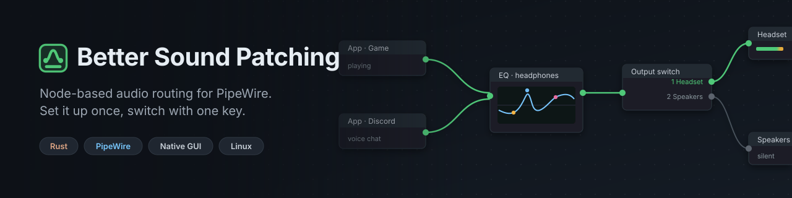
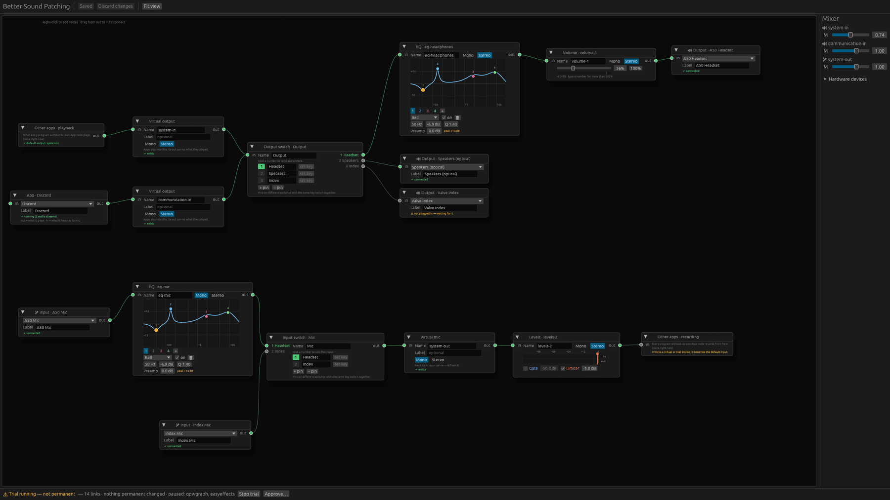
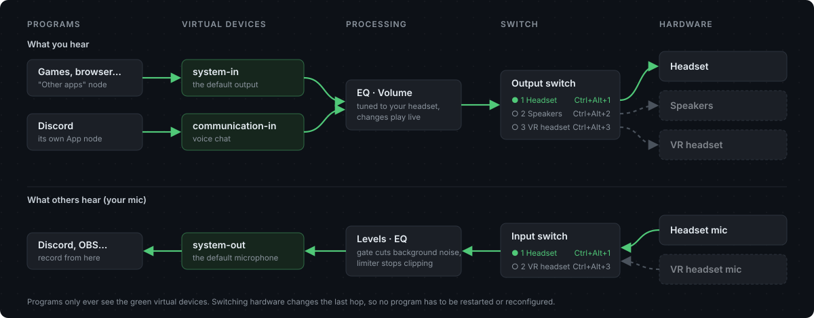
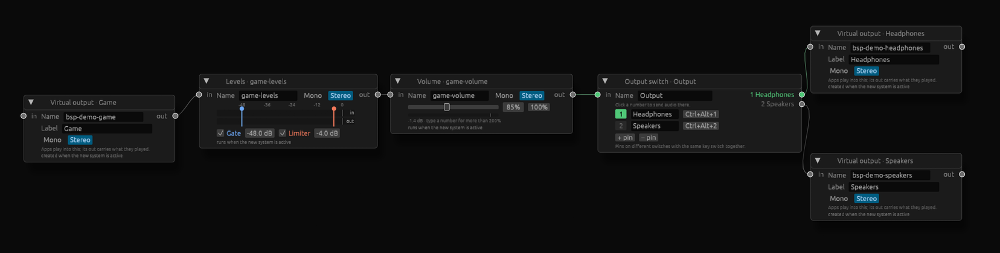

<p align="center">
  
</p>

<p align="center">
  
  
  
  
</p>

**Better Sound Patching** (`bsp`) is a Voicemeeter-style patchbay for Linux. You draw how audio should
flow (programs, virtual devices, equalizers, level controls, and your real hardware) as a node graph,
and a small daemon keeps PipeWire wired exactly that way. Plug a device in, restart a program, or
switch from headset to speakers with one key: the routing stays what you drew.

It is written entirely in Rust with a native GUI. There is no Electron, no web view, and no JavaScript.

<p align="center">
  
</p>

## Highlights

- **One graph, wired live.** While the new system runs, every edit plays immediately: drag a wire or
  an EQ band and hear it. **Save** keeps your changes, **Discard changes** reverts them.
- **Stable virtual devices.** Programs play into `system-in`, talk into `communication-in` and record
  from `system-out`. They never see your hardware, so changing hardware never confuses them.
- **Switch nodes instead of profiles.** Pick the active output or microphone by clicking a pin, from a
  terminal, or with a **global keyboard shortcut**. Pins on different switches that share a key change
  together, so one key can move both output and mic to your VR headset.
- **Built-in processing.** A parametric **EQ** with a draggable curve, a **Levels** node (meters, noise
  gate, limiter) and a **Volume** node all run inside the daemon on PipeWire's realtime thread.
- **Per-program routing.** Give Discord (or anything else) its own node; every other program follows the
  "Other apps" nodes, which set the system default devices.
- **Unused hardware stays silent**, like Voicemeeter: nothing reaches a device unless the graph says so.
- **Safe to try.** A trial changes nothing permanent. Stop it, or reboot, and your old setup is back.

## How it works

<p align="center">
  
</p>

The daemon owns everything it creates (links, virtual devices, processing nodes) with
`object.linger = false`, so if it stops or crashes, it all disappears with it. When it lets go of a
program, it hands that program back to the default device first, so nothing is ever left silent.

## Nodes

<p align="center">
  
</p>

| Node | What it does |
|---|---|
| **Virtual output / Virtual mic** | A device programs can play into or record from. Created by the daemon. |
| **Input device / Output device** | A real microphone, headset or speaker. Shows whether it's plugged in. |
| **App** | One program. Its *out* is what it plays, its *in* is what it hears as a microphone. |
| **Other apps · playback / recording** | Every program without its own App node. Wiring them to a device makes it the system default. |
| **Equalizer** | Up to 32 bands (bell, shelves, low and high pass, notch) with a live response curve. |
| **Levels** | Input and output meters, a noise gate (bottom limit) and a limiter (top limit). |
| **Volume** | A 0–200% slider, or type any value up to 1000%. |
| **Output switch / Input switch** | Numbered pins; exactly one is live. Click it, run `bsp select`, or press its key. |

## Getting started

### Requirements

- Linux with **PipeWire** 1.x and **WirePlumber** 0.5
- **Rust** 1.95 or newer and **clang**, which the PipeWire bindings need to build
- Optional: a desktop with the XDG GlobalShortcuts portal (KDE Plasma 6, for example) for global keys

### Build

```sh
git clone https://github.com/Exouxas/better-sound-patching.git
cd better-sound-patching
cargo build --release
./target/release/bsp            # opens the editor
```

### Adopt it safely

Nothing changes until you ask, and every step can be undone:

| Step | What changes | How to undo |
|---|---|---|
| `bsp` / `bsp plan` | Nothing. The editor and the dry run only read. | — |
| `bsp trial` (or **Try the new system…**) | Routing follows your graph; qpwgraph and EasyEffects are paused for this session. | `bsp stop`, or reboot |
| `bsp approve` | Installs `~/.local/bin/bsp` and a systemd user service; moves conflicting autostart entries aside. | `bsp revert` |

## Command line

```text
bsp                         Open the editor and mixer
bsp plan                    Dry run: what the graph would change right now
bsp trial                   Start a trial (nothing permanent)
bsp stop                    Stop and give control back to your old setup
bsp select Output 2         Make a switch use pin 2
bsp key Ctrl+Alt+3          Act as if that shortcut was pressed
bsp status                  Show what the daemon is doing
bsp approve | revert        Start at login / undo that
bsp restore                 Relaunch programs a trial paused (after a crash)
```

## Configuration

Everything lives in `~/.config/better-sound-patching/` as plain TOML, safe to back up or put in git:

| File | Contents |
|---|---|
| `graph.toml` | The routing graph: nodes, their settings and the wires between them |
| `state.toml` | Which pin each switch is using |
| `labels.toml` | Your own names for devices and programs |

## Design notes

- **No JavaScript, no web stack.** GUI: [egui](https://github.com/emilk/egui) with
  [egui-snarl](https://github.com/zakarumych/egui-snarl). Audio: [pipewire-rs](https://gitlab.freedesktop.org/pipewire/pipewire-rs),
  plus a small FFI layer for `pw_filter`.
- **Pure planning.** The planner turns *graph + live PipeWire state* into the exact set of links that
  should exist. It makes no PipeWire calls, so it is fully unit-tested.
- **Allocation-free DSP.** EQ biquads run in 64-bit floats; the limiter has an instant attack, so no
  sample ever exceeds its ceiling.
